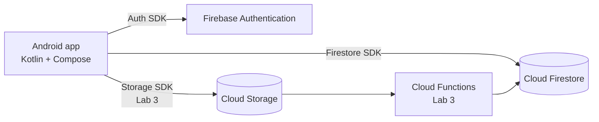

# CaughtU

**Problem statement:** Students who use Instagram can't safely see who doesn't follow them back, because existing apps demand their Instagram password and a weekly subscription.

CaughtU reads the official Instagram *"Download your information"* export instead — no Instagram login, no password sharing — and shows who doesn't follow you back, your fans and your mutuals. Snapshots are saved to the cloud so you can track changes over time.

> Android port of the CaughtU iOS app · Team Project – Mobile Application in the Cloud

## Team – se7team

| Member | Role |
| --- | --- |
| Jungwon Jung ([@jungwonJung](https://github.com/jungwonJung)) | Product Owner · Tech Lead · Developer · QA/DevOps (one-person team) |

## MVP features

| # | Feature | Sprint |
| --- | --- | --- |
| 1 | Register, log in, log out, auto-login (Firebase Auth) | **Sprint 1** (Lab 1) |
| 2 | Upload an Instagram export (ZIP / HTML / JSON) and analyse it | **Sprint 1** (Lab 2) |
| 3 | Snapshot list screen (my saved analyses) | **Sprint 1** (Lab 2) |
| 4 | Snapshot detail: Don't follow back / Fans / Mutuals + edit label & note | **Sprint 1** (Lab 2) |
| 5 | Compare two snapshots – who unfollowed me | Later |
| 6 | Cloud parsing: upload ZIP to Storage, Cloud Function parses it | Later (Lab 3) |

Screens (5): Login · Register · Snapshot list · Snapshot detail/edit · Upload

## Data model (Cloud Firestore)

| Collection | Fields (type) |
| --- | --- |
| `users` | uid (doc id) · email (string) · displayName (string) · createdAt (timestamp) |
| `snapshots` | **ownerId** (string) · label (string) · note (string) · followerCount (number) · followingCount (number) · notFollowingBackCount (number) · createdAt (timestamp) |
| `entries` | **ownerId** (string) · snapshotId (string) · username (string) · relation (string: `notFollowingBack` / `fan` / `mutual`) · followedAt (timestamp) |

`ownerId` links every document to the Firebase Auth uid of its owner.

## Architecture

Inside the app: `data` (AuthRepository → Firebase) · `domain` (AuthValidator) · `ui` (screens + ViewModels, Navigation Compose).

## How to run

1. Install Android Studio (latest stable) with an emulator image that includes Google Play.
2. `git clone https://github.com/jungwonJung/caughtu-android.git` and open the folder in Android Studio.
3. `app/google-services.json` is committed, so the Firebase project `caughtu-se7team` works out of the box.
4. Wait for Gradle sync, then **Run ▶ app** (min SDK 26).
