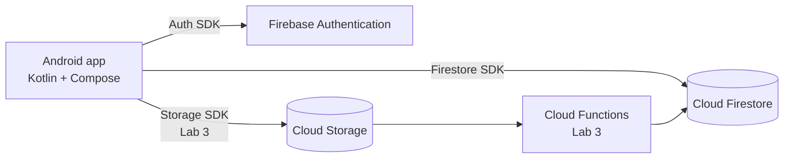

# CaughtU

**Problem statement:** Students who use Instagram can't safely see who doesn't follow them back, because existing apps demand their Instagram password and a weekly subscription.

CaughtU reads the official Instagram *"Download your information"* export instead — no Instagram login, no password sharing — and shows who doesn't follow you back, your fans and your mutuals. Each analysis is saved as a snapshot so you can track changes over time. **Privacy:** only the counts and your own label/note go to the cloud – the export file and the usernames in it never leave the phone.

## Team – se7team

| Member | Role |
| --- | --- |
| Jungwon Jung ([@jungwonJung](https://github.com/jungwonJung)) | Product Owner · Tech Lead · Developer · QA/DevOps (one-person team) |

## Definition of Done

A story is done when:

1. It is merged to `main` through a PR that says `Closes #…`, after I review and test my own changes (one-person team, no second reviewer).
2. It works on a second device (a physical phone or a second emulator), signed in as a second account.
3. It does not crash on invalid input, screen rotation or Back.
4. Its acceptance criteria are ticked and its issue is closed.

## MVP features

| # | Feature | Sprint |
| --- | --- | --- |
| 1 | Register, log in, log out, auto-login (Firebase Auth) | **Sprint 1** (Lab 1) |
| 2 | Upload an Instagram export (ZIP / HTML / JSON) and analyse it | **Sprint 1** (Lab 2) |
| 3 | Snapshot list screen (my saved analyses) | **Sprint 1** (Lab 2) |
| 4 | Snapshot detail: Don't follow back / Fans / Mutuals + edit label & note | **Sprint 1** (Lab 2) |
| 5 | Compare two snapshots – who unfollowed me | Later |
| 6 | Cloud parsing: upload ZIP to Storage, Cloud Function parses it | Later (Lab 3) |

Screens (5): Login · Register · Snapshot list · Snapshot detail/edit · Upload

## Tech stack

| Layer | Choice |
| --- | --- |
| App framework | Kotlin 2.2 + Jetpack Compose (Material 3), Navigation Compose, min SDK 26 |
| Backend | Firebase (project `caughtu-se7team`, Spark free plan) |
| Database | Cloud Firestore, location **eur3 (Europe)**, production mode |
| Auth | Firebase Authentication (email + password) |
| Access control | Firestore Security Rules (`firestore.rules`, deployed with `firebase deploy --only firestore:rules`) |
| Test tools | JUnit 4 (JVM unit tests), Firebase Rules Playground / REST calls for rule scenarios |

## Data model (Cloud Firestore)

Who sets a field: **user** = typed or picked in the form · **app** = written by the app from the session / reference data · **server** = `FieldValue.serverTimestamp()` (server clock).

### `snapshots` (main collection – users create, edit, delete)

| Field | Type | Set by | Notes |
| --- | --- | --- | --- |
| *(document id)* | string | server | auto id |
| `ownerId` | string | app | Firebase Auth uid of the signed-in user, never user input |
| `label` | string | user | 1–40 characters |
| `note` | string | user | 0–200 characters |
| `typeId` | string | user | id of a `snapshotTypes` document (picked from a list) |
| `typeName` | string | app | copied from the picked type, for the list screen |
| `exportedAt` | timestamp | user | date of the Instagram export, not in the future |
| `followerCount` | number (int) | user | ≥ 0 |
| `followingCount` | number (int) | user | ≥ 0 |
| `notFollowingBackCount` | number (int) | user | ≥ 0 and ≤ `followingCount` |
| `createdAt` | timestamp | server | set once on create, never changed |
| `updatedAt` | timestamp | server | set on create and on every update |

### `snapshotTypes` (reference collection – read-only for users)

| Field | Type | Set by | Notes |
| --- | --- | --- | --- |
| *(document id)* | string | admin | e.g. `weekly`, `monthly`, `before-cleanup`, `after-cleanup` |
| `name` | string | admin | shown in the picker |
| `intervalDays` | number (int) | admin | suggested days between checks (0 = one-off) |
| `order` | number (int) | admin | sort order in the picker |

Reference data is seeded with `scripts/seed-snapshot-types.sh`; the app can never write it.

## Architecture

Inside the app: `data` (repositories – the only code that talks to Firebase) · `domain` (pure Kotlin validators and list logic) · `ui` (screens + one ViewModel per screen, Navigation Compose).

## How to run

1. Install Android Studio (latest stable) with an emulator image that includes Google Play.
2. `git clone https://github.com/jungwonJung/caughtu-android.git` and open the folder in Android Studio.
3. `app/google-services.json` is committed, so the Firebase project `caughtu-se7team` works out of the box.
4. Wait for Gradle sync, then **Run ▶ app** (min SDK 26).

### Backend (maintainers)

- Deploy rules: `firebase deploy --only firestore:rules`
- Seed reference data: `./scripts/seed-snapshot-types.sh` (needs `firebase login` as a project owner)
- Check the access rules: set `RULES_A_EMAIL`, `RULES_A_PASSWORD`, `RULES_B_EMAIL`, `RULES_B_PASSWORD` (two test users) and run `python3 scripts/rules_scenarios.py` – prints the 8-scenario results table, exits 1 on any mismatch
